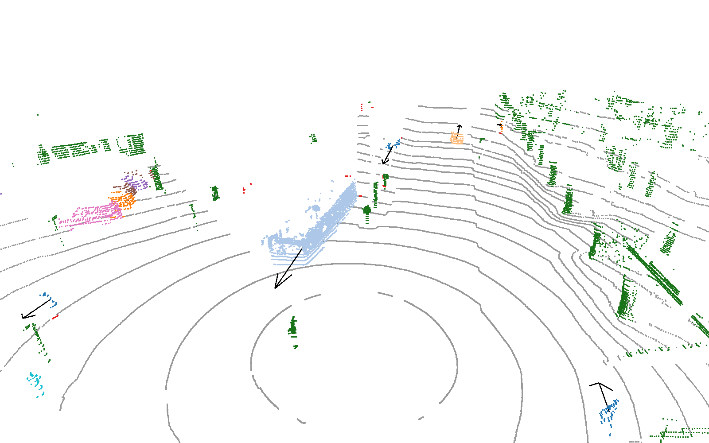

# lidar_panoptic_segmentation

## Demo

A neural network that labels every point of a rotating lidar's scan in one pass: ground, static obstacle or dynamic
obstacle; object instances of the dynamic points; a semantic class from one of four dataset label sets; and, from the 4
previous scans, the over-ground velocity of every dynamic object. This repository holds the model as an ONNX file (fp16, and
the fp32 original), an example scan from our car and one script to run them.

[Demo video: the model on our car in Tartu](https://youtu.be/r0lbQwu6Mmk?si=keMga1_NuFt5JODf)



The example scan (`example.pcd`, Tartu, 2026-04-22) seen from above and behind the car: ground grey, static obstacles
green, dynamic objects coloured by instance, dynamic points without an instance red, black arrows the velocity of
moving objects (1 s ahead). A bus approaches from ahead on the left; pedestrians and parked cars all around.

## Quick start

```bash
pip install -r requirements.txt
python segment.py example.pcd
```

prints (CPU; the object list abbreviated):

```
pseg_v6.2_fp16.onnx on CPUExecutionProvider, dataset unknown: 47827 points, 4 previous scans
  ground 19632, static 9742, dynamic 6072, none 12381 (outside the grid, above max_height or isolated)
38 objects (dynamic points without an instance: 251):
    1  vehicle.car                            121 points  speed  0.0 m/s
    ...
   10  human.pedestrian.adult                  92 points  speed  1.3 m/s
    ...
   17  vehicle.bus.rigid                     3413 points  speed  7.0 m/s
    ...
   24  vehicle.truck                          342 points  speed 11.0 m/s
    ...
```

`segment.py` reads the previous scans `example_sweep_1.pcd` .. `example_sweep_4.pcd` (1 = newest) with time lags of
0.1, 0.2, 0.3 and 0.4 s (`SWEEP_PERIOD` in the script, a 10 Hz lidar), and uses the CUDA provider of onnxruntime if it is available, else the CPU.
Options:

- `--model pseg_v6.2_fp16.onnx`: the ONNX file, the fp16 one (default) or the fp32 one `pseg_v6.2.onnx`;
- `--dataset unknown`: the style, class head and intensity mapping, one of `nuscenes`, `semantickitti`, `waymo`,
  `pandaset`, `unknown` (see [Styles and datasets](#styles-and-datasets));
- `--lidar_height 2.11`: the lidar's height above the ground (m);
- `--no-sweeps`: without previous scans (segmentation stays, velocity is not usable);
- `--show`: interactive 3D view, `--plot out.png`: the same scene rendered offscreen to a PNG. Both need
  `pip install open3d` (tested with 0.19.0); the printed object list is their legend. `--plot` renders through EGL: it
  works on a desktop or a machine with an NVIDIA driver, not on a headless machine without one;
- `--out results.npz`: the per-point results (points, group, inst, native, velocity, class_names);
- `--cpu`: the CPU even if CUDA is available; `--trt`: TensorRT fp16 through onnxruntime's TensorRT provider
  (onnxruntime-gpu built with TensorRT), with the inputs padded to 65536 / 262144 rows so that one engine is built
  (the first run builds it, minutes; it is cached in the working directory);
- `--repeat N`: N more runs on the same inputs, and the median time of the model per scan (`session.run` only, without
  loading the model or creating the session), with the pre-processing time (reading, filtering, padding) separately.

## Model

- **Input:** the current scan (x, y, z, raw intensity in the lidar frame), the 4 previous scans moved into the
  current lidar frame with their time lags, and the dataset index that selects the style.
- **Network:** a per-point MLP max-pooled into a 0.2 m bird's-eye-view grid over +-76.8 m (768 x 768 cells, 4 height
  slices), a residual CNN backbone with an FPN neck at 0.4 m, and heads for a BEV object-centre heatmap, per-point
  group, thing, offset to the object centre and classes (one head per training dataset), and a BEV velocity map on its
  own neck. A learned style embedding modulates the encoder, backbone and point head.
- **Decoding inside the graph:** heatmap peaks are object centres; dynamic thing points shifted by their predicted
  offset join the nearest centre within 2 m. A local ground height is estimated from the ground points, and points more
  than `max_height` above it (canopy) are dropped. Isolated static points within `filter_range` are dropped as noise.
  Obstacle points without an instance that move faster than 2 m/s within 1 m of an instance join it, and dynamic points
  without an instance within 1 m of a vehicle instance join it unless they are classed as a person or two-wheeler
  (fragments of long vehicles).
- **Output per point:** group (ground / static / dynamic / none), instance id of dynamic points (per scan, not
  tracked), class, xy velocity of its object.
- **fp16 and fp32:** `pseg_v6.2.onnx` (30 MB) is the exported fp32 graph. `pseg_v6.2_fp16.onnx` (16 MB) has the
  network in fp16: every node of the network module (point MLP,
  max-pooling scatter into the BEV grid, style embedding and modulation, backbone, FPN necks and heads), converted by
  onnxruntime's float16 converter with fp32 inputs and outputs (`keep_io_types`). The graph's own pre- and
  post-processing (intensity mapping, heatmap peaks, instance assignment, local ground height, filters, the fragment and
  velocity rules) stays fp32. Against the fp32 graph on the full validation splits, PQ drops by 0.019 on nuScenes and
  by 0.002-0.005 on SemanticKITTI, Waymo and PandaSet, and the official metrics by up to 0.025 (see
  [Results](#results)). TensorRT's own fp16 mode applied to the fp32 graph lost less on our data (-0.0025 PQ), so with
  TensorRT the fp32 file may be the better input (`--model pseg_v6.2.onnx --trt`; not measured for this file).
- **Input size:** `points` and `sweeps` accept any number of rows. A whole 64-beam scan can be passed. Padding rows
  `(1e4, 0, 0, 0[, 0])` are ignored, and fixed-size padded inputs (65536 / 262144 rows) give TensorRT a single input
  shape (`segment.py --trt`).

The model was trained with the lab's training code, which is not public. The sibling demo
[lidar_pillar_detector](https://github.com/UT-ADL/lidar_pillar_detector) does the same for the lab's 3D box detector.

**Limitations:**

- Trained on 32-64 beam rotating lidars at 10-20 Hz; other sensors (solid-state, much denser or sparser scans) are
  outside the training distribution.
- Instance ids are per scan; there is no temporal identity (use a tracker).
- The previous scans must be motion-compensated by the caller; wrong poses give wrong velocities.
- Long vehicles (buses, trucks with trailers) are sometimes split into two objects at long range.
- Static objects with instance labels in the datasets (barriers, traffic cones) are static points, not instances.

## ONNX interface

Inputs:

| name | shape | dtype | meaning |
|---|---|---|---|
| `points` | (N, 4) | float32 | the current scan, any number of points N: x, y, z (m, lidar frame: x forward, y left, z up, origin at the lidar), raw intensity (VLP-32C: 0-255). Padding rows `(1e4, 0, 0, 0)` (a point far outside the grid) are ignored, e.g. to pad to a fixed size for TensorRT. `segment.py` drops points closer than 2.7 m (the minimum range of our lidar driver). |
| `sweeps` | (M, 5) | float32 | the previous 4 scans, any number of rows M, see [Multi-sweep input](#multi-sweep-input). Padding `(1e4, 0, 0, 0, 0)`; no history: one padding row |
| `max_height` | (1,) | float32 | non-ground points more than this above the local predicted ground get group -1 (`segment.py`: 2.5 m) |
| `lidar_height` | (1,) | float32 | the lidar's height above the ground in m (our car: 2.11) |
| `filter_range` | (1,) | float32 | within this range (m), static points with fewer than `min_static_points` static points in the surrounding 3 x 3 cells of 0.2 m are dropped as noise (`segment.py`: 38 m; beyond it a real obstacle hit by one VLP-32C beam can have fewer returns) |
| `dataset` | (1,) | int64 | index into the `datasets` metadata: the style embedding, the class head of `native` and the intensity mapping (see [Styles and datasets](#styles-and-datasets)) |

Outputs (one row per row of `points`, N; padding rows give -1 / 0):

| name | shape | dtype | meaning |
|---|---|---|---|
| `group` | (N,) | int32 | 0 ground, 1 static, 2 dynamic, -1 none (padding, outside the grid, above `max_height`, isolated static point) |
| `inst` | (N,) | int32 | instance id 1..256 of dynamic points with an object centre, 0 none; ids are per scan. Dynamic points without an instance can be grouped by connected 0.5 m cells. |
| `native` | (N,) | int32 | class index into `class_names[dataset]` (for `unknown`: the nuScenes classes) |
| `velocity` | (N, 2) | float32 | over-ground xy velocity of the point's object, m/s, lidar frame axes |

Metadata (`metadata_props`):

| key | value | meaning |
|---|---|---|
| `datasets` | `["nuscenes", "semantickitti", "waymo", "pandaset", "unknown"]` | the values 0-4 of the `dataset` input |
| `class_names` | JSON object `{dataset: [names]}` for the four datasets | `native` index -> class name of that dataset's head; `unknown` uses `nuscenes` (30 classes: `animal`, `human.pedestrian.*`, `movable_object.*`, `static_object.bicycle_rack`, `vehicle.*`, `flat.*`, `static.*`) |
| `intensity` | `{"nuscenes": "quantile:nuscenes", "semantickitti": "quantile:kitti", "waymo": "quantile:waymo", "pandaset": "quantile:pandaset", "unknown": "quantile:av2"}` | the intensity mapping per dataset: raw intensity to [0, 1] by a quantile table of that dataset's lidar (`unknown`: of Argoverse 2's VLP-32C lidars) |
| `sweeps` | `4` | number of previous scans |
| `sweep_points` | `262144` | rows of the `sweeps` input at export; the size to pad to for a fixed input shape (with 65536 rows of `points`) |
| `dynamic_points` | `true` | `points` and `sweeps` accept any number of rows |
| `velocity` | `true` | the model has the `velocity` output |
| `moving_static_speed` | `2.0` | obstacle points without an instance faster than this (m/s) within 1 m of an instance join it |
| `moving_agree` | `1.5` | ... if their velocity is within this (m/s) of the instance's |
| `pseg` | JSON | the network configuration (`cfg`: grid x / y -76.8..76.8 m, z -1..3 m above the ground in 4 slices, voxel 0.2 m, output stride 2, sweeps 4, velocity map on its own neck) and the export constants: `height` 2.11 (lidar height at export), `embed` `input`, `head` `nuscenes` (the classes the fragment rule uses), `points` 65536, `ground_cell` 1.0 m, `min_static_points` 4, `dynamic_bias` 2.0 (added to the dynamic group logit), `fragment_dist` 1.0 and `fragment_classes` `into_vehicle` (the fragment rule), `stuff_fallback` "", `spray_height` 0.0, `spray_range` 30.0 (rain spray rule, off) |

## Styles and datasets

The model was trained on the union of four public lidar datasets. Each has its own class head, and all share the
ground / static / dynamic, thing, instance and velocity heads. A learned style embedding per dataset adapts the network
to each sensor and labelling convention, plus an "unknown" style trained on 10% of the frames for lidars that are none
of the four. The `dataset` input selects the style, the class head of `native` and the intensity table: 0-3 for the
four training datasets, 4 for `unknown` (nuScenes classes, the VLP-32C intensity table), the setting for a new lidar.

| dataset | training frames | validation frames | what it contributed | licence (quoted from the terms) | URL |
|---|---|---|---|---|---|
| nuScenes with nuScenes-lidarseg and Panoptic nuScenes | 28130 | 6019 | Velodyne HDL-32E scans, 20 Hz; point classes and instances, sweeps, instance velocities | "Unless specifically labeled otherwise, these Datasets are provided to You under a Creative Commons Attribution-NonCommercial-ShareAlike 4.0 International Public License ("CC BY-NC-SA 4.0"), with the additional terms included herein." (nuScenes Terms of Use, 16 Nov 2021) | https://www.nuscenes.org/terms-of-use |
| SemanticKITTI (on KITTI odometry) | 19130 (sequences 00-07, 09, 10) | 4071 (sequence 08) | Velodyne HDL-64E scans, 10 Hz; point classes and instances | SemanticKITTI is based on the KITTI Vision Benchmark and distributed under CC BY-NC-SA 4.0. KITTI: "published under the Creative Commons Attribution-NonCommercial-ShareAlike 3.0 License" | https://www.semantic-kitti.org/dataset.html |
| Waymo Open Dataset v2 (3D semantic segmentation) | 23691 | 5976 | Waymo top-lidar scans; point classes and instances, instance velocities | Waymo Dataset License Agreement for Non-Commercial Use (March 2025): use for "research, teaching, scientific publication and personal experimentation"; "You may publish, in whole or in part, trained model architectures, including weights and biases" with the notice, a copy of the Agreement and attribution (Section 2(c)) | https://waymo.com/open/terms |
| PandaSet | 4880 | 1200 (held-out sequences) | Hesai Pandar64 scans, 10 Hz; point classes, instances from cuboids | "Unless specifically labeled otherwise, these Datasets are provided to You under a Creative Commons Attribution 4.0 International Public License ("CC BY 4.0"), with the additional terms included in these Dataset Terms." (PandaSet Dataset Terms of Use) | https://pandaset.org |

Frames are the labelled scans: nuScenes keyframes (2 Hz), Waymo segmentation frames (about 2 Hz), SemanticKITTI and
PandaSet scans (10 Hz). Training draws stratified batches with every dataset in each batch, weighted by the square
root of its size (SemanticKITTI and PandaSet counted at every 5th frame, as their 10 Hz scans are nearly repeated):
20 epochs x 2000 steps x 32 frames = 1.28 M samples, then a 4-epoch fine-tune of the whole network with the velocity map added (0.26 M). The
validation splits were never trained on.

Argoverse 2 (22477 training / 4806 validation frames, the training split not used), ONCE (4961 / 3321) and Lyft Level
5 (21419 / 1260) were not trained on, only evaluated: they have 3D boxes but no per-point labels, and training on labels
derived from their boxes (the points inside a box as the object, the rest unsupervised) gave no gain over the four
segmentation datasets.

## Multi-sweep input

The `sweeps` input holds the previous 4 scans of the same lidar, newest first, concatenated and padded to 262144 rows:
x, y, z in the **current** lidar frame, the raw intensity, and the time lag in seconds (current scan time minus that
scan's time, positive). The caller moves each previous scan into the current lidar frame with its pose:
`p_current = inv(T_current) @ T_previous @ p_previous`, with the lidar poses `T` in a fixed frame (odometry or map).
Trained lags are about 0.1-0.41 s (10 Hz); leave out scans older than 0.45 s. With no history (the first scans after a
start), fill the input with padding: segmentation stays almost the same, but the velocity is not usable.

In this repository `example_sweep_1.pcd` .. `example_sweep_4.pcd` are the 4 scans before `example.pcd`, moved into its
lidar frame with the car's recorded GNSS/INS localization, with the 2.7 m minimum range applied in their own frame.
Their lags are 0.1, 0.2, 0.3 and 0.4 s (`SWEEP_PERIOD` x k in `segment.py`, rounded from the recorded 0.0995, 0.1997,
0.2999 and 0.3995 s). All are binary PCD with float32 x y z intensity, the intensity raw as from the Velodyne VLP-32C (10 Hz,
mounted 2.11 m above the ground on the car's roof).

## Results

All numbers are on the full validation splits, with each segmentation set's own style and class head through the
`dataset` input and the box-labelled sets with `unknown`. The first value is `pseg_v6.2_fp16.onnx`; the value in
brackets is the fp32 file `pseg_v6.2.onnx`. All runs use onnxruntime 1.20 (CUDA provider) on whole scans.

**Official metrics** of the four segmentation datasets:

| Dataset, split, frames | Metric (tool) | fp16 (fp32) |
|---|---|---|
| nuScenes, val, 6019 keyframes | Panoptic nuScenes PQ / PQ-dagger / SQ / RQ, 16 classes (nuscenes-devkit 1.2.0, `NuScenesPanopticEval`, min_inst_points 15) | 0.495 / 0.539 / 0.815 / 0.582 (0.508 / 0.550 / 0.818 / 0.596) |
| | PQ things / stuff (mean of the devkit's per-class PQ over its 10 thing and 6 stuff classes) | 0.395 / 0.660 (0.405 / 0.680) |
| | lidarseg mIoU, 16 classes (nuscenes-devkit 1.2.0, `LidarSegEval`) | 0.606 (0.631) |
| SemanticKITTI, sequence 08, 4071 scans | PQ / PQ-dagger / SQ / RQ, 19 classes (semantic-kitti-api a9c749e, `evaluate_panoptic.py`, min instance points 50) | 0.430 / 0.502 / 0.700 / 0.526 (0.439 / 0.507 / 0.704 / 0.535) |
| | PQ things / stuff | 0.398 / 0.453 (0.401 / 0.466) |
| | mIoU, 19 classes (`evaluate_semantics.py`) | 0.515 (0.521) |
| Waymo Open Dataset v2, validation, 5976 frames | mIoU as defined by the Waymo 3D semantic segmentation challenge (23 classes, `TYPE_UNDEFINED` ignored: 22 scored), computed with our implementation; waymo-open-dataset 1.6.4-1.6.7 has no lidar segmentation metric op, and there is no official lidar panoptic metric | 0.573 (0.581) |
| PandaSet, held-out sequences, 1200 frames | mIoU over its semantic classes present in the split (36), our implementation; PandaSet has no official benchmark tool | 0.307 (0.309) |

How the official metrics differ from ours and what was mapped:

- The official PQ is averaged per class over things and stuff. The graph gives instances to dynamic points only, so
  static thing classes are never instances: nuScenes barrier PQ 0.030, traffic cone 0.27, against car 0.90 and
  pedestrian 0.84. SemanticKITTI's things are all dynamic.
- nuScenes: the head's 30 lidarseg classes are mapped to the devkit's 16 with its own class mapper. The devkit accepts
  no prediction outside them, so classes the challenge ignores take the nearest challenge class: persons and animals
  pedestrian, emergency vehicles car, debris, bicycle racks and static.other manmade. Points beyond the +-76.8 m grid,
  which get no prediction, are set to manmade on nuScenes, to unlabelled (counted as wrong) on SemanticKITTI, and
  counted as wrong for Waymo and PandaSet. Thing points without an instance get instance 0.
- The panoptic evaluators compute PQ per class with an IoU > 0.5 match; ours is class-agnostic (below).

**Our metrics** on all seven sets:

| Dataset | Validation frames | Style, classes | Previous scans available | Our PQ: 4 previous scans fp16 (fp32) / none, fp16 | Recall, fp16 |
|---|---|---|---|---|---|
| nuScenes | 6019 | own | 4 (0.1-0.4 s) | 0.764 (0.783) / 0.718 | 0.840 (50-75 m) |
| SemanticKITTI | 4071 | own | 4 | 0.839 (0.843) / 0.812 | 0.965 (50-75 m) |
| Waymo Open Dataset v2 | 5976 | own | 4 | 0.855 (0.857) / 0.834 | 0.966 (50-75 m) |
| PandaSet | 1200 | own | 4 | 0.857 (0.860) / 0.832 | 0.986 (50-75 m) |
| Argoverse 2 | 4806 | unknown | 4 | 0.853 / 0.827 | 0.998 (box points) |
| ONCE | 3321 | unknown | none (its frames are 0.5 s apart, beyond the trained 0.45 s) | 0.798 / 0.798 | 0.996 (box points) |
| Lyft Level 5 | 1260 | unknown, intensity 0 | 2 (0.2, 0.4 s) | 0.918 / 0.891 | 0.996 (box points) |

- **Our PQ:** class-agnostic panoptic quality over the labelled instances of dynamic classes (vehicles, pedestrians,
  cyclists, animals) with at least 10 points within 2.7-75 m. A predicted object is an instance, or a connected group
  of 0.5 m cells of dynamic points without an instance. A prediction matches an instance at IoU > 0.5, and unmatched
  predictions count as false positives unless most of their points are labelled stuff, ground or ignored. PQ = SQ x
  RQ, as in the panoptic literature.
- **Recall:** the share of labelled obstacle points (up to 2 m above the labelled ground) at 50-75 m that the graph
  keeps as obstacles (static or dynamic). For the box sets, it is the share of the points inside labelled boxes of dynamic classes
  kept as obstacles, because the rest of their scans has no labels (it includes the road).
- **Box sets:** an instance is the set of points inside a labelled box, so PQ also depends on how tightly the boxes
  fit and which classes were labelled. Lyft's intensity is a constant 100 in its release and is passed as 0 here: with
  the raw value, the VLP-32C intensity table of `unknown` misreads every point and 41% of the objects are missed (PQ
  0.509). ONCE's intensity has another scale than the VLP-32C table as well (PQ as shipped).

**Inference time** per scan, the model only (`segment.py --repeat 20`: the median of `session.run` without loading the
model or creating the session), on the example scan (47827 points) with its 4 previous scans:

| hardware | runtime | time per scan |
|---|---|---|
| NVIDIA RTX 2080 Ti | TensorRT fp16 (`--trt`, onnxruntime-gpu 1.18.1 TensorRT provider, TensorRT 10.0, CUDA 11.8) | 24 ms (23 ms with the cached engine; the first run builds it in about 5.5 min) |
| NVIDIA RTX 2080 Ti | onnxruntime-gpu 1.18.1 CUDA provider | 72 ms |
| 2 x Intel Xeon Silver 4108 1.8 GHz, 32 threads | onnxruntime 1.18.1 CPU provider | 5.5 s |
| AMD EPYC 7763, 16 threads | onnxruntime 1.19 CPU provider | 2.8 s (2.3 s without previous scans) |

Pre-processing (reading the five PCD files, the range filter, padding) adds 10-14 ms. The fp16 GPU runs give
slightly different results from the CPU run (37-39 objects against 38 on the example scan; the fp32 file gives 35 on
the CPU, with 162 dynamic points without an instance); the Quick start output is the fp16 CPU one. The script prints the provider it runs on: an onnxruntime-gpu build for another CUDA or cuDNN version
than the machine's fails to load its CUDA provider and falls back to the CPU.

## License

- **Code** (`segment.py`): MIT, see [LICENSE](LICENSE).
- **Model weights** (`pseg_v6.2.onnx`, `pseg_v6.2_fp16.onnx`): licensed under
  [CC BY-NC-SA 4.0](https://creativecommons.org/licenses/by-nc-sa/4.0/), copyright 2026 University of Tartu,
  Autonomous Driving Lab, together with the Waymo Dataset License Agreement for Non-Commercial Use below. The weights
  were derived by training on nuScenes, SemanticKITTI, the Waymo Open Dataset and PandaSet (see
  [Styles and datasets](#styles-and-datasets)); the most restrictive of their terms apply: non-commercial use only,
  share-alike, attribution. Where the two licences differ, the more restrictive term applies.
- **Waymo Open Dataset notice** (required by Section 2(c) of its licence): This model was made using the Waymo Open
  Dataset, provided by Waymo LLC under the Waymo Dataset License Agreement for Non-Commercial Use, available at
  [waymo.com/open/terms](https://waymo.com/open/terms), and your access and use of such work are governed by the terms
  and conditions therein. This model is released under that Agreement, and any further downstream use or modification
  of it is subject to the terms of that Agreement, including the non-commercial restrictions of its Section 4.
  A copy of the Agreement is included as [WAYMO_LICENSE.txt](WAYMO_LICENSE.txt). Section 4(a) of the Agreement reads:
  "You must not use or deploy the Dataset, any models trained on or refined using the Dataset, or the weights or
  biases from such trained models, in whole or in part, (i) in operation of a vehicle or to assist in the operation of
  a vehicle, (ii) in any Production Systems, or (iii) for any other primarily commercial purposes".
- **Attribution** when you use or share the weights:
  - University of Tartu, Autonomous Driving Lab (the model);
  - nuScenes, nuScenes-lidarseg and Panoptic nuScenes (Motional): H. Caesar et al., "nuScenes: A multimodal dataset
    for autonomous driving", CVPR 2020; W. K. Fong et al., "Panoptic nuScenes: A Large-Scale Benchmark for LiDAR
    Panoptic Segmentation and Tracking", RA-L 2022;
  - SemanticKITTI: J. Behley et al., "SemanticKITTI: A Dataset for Semantic Scene Understanding of LiDAR Sequences",
    ICCV 2019; KITTI: A. Geiger, P. Lenz, R. Urtasun, "Are we ready for Autonomous Driving? The KITTI Vision Benchmark
    Suite", CVPR 2012;
  - the Waymo Open Dataset, provided by Waymo LLC: P. Sun et al., "Scalability in Perception for Autonomous Driving:
    Waymo Open Dataset", CVPR 2020;
  - PandaSet (Scale AI and Hesai): P. Xiao et al., "PandaSet: Advanced Sensor Suite Dataset for Autonomous Driving",
    ITSC 2021.

  No dataset provider endorses this model or its use.
- **Example scans** (`example.pcd`, `example_sweep_*.pcd`, `example.png`): the lab's own data,
  licensed under [CC BY 4.0](https://creativecommons.org/licenses/by/4.0/), credit: University of Tartu, Autonomous
  Driving Lab.

**Credits:** Autonomous Driving Lab, Institute of Computer Science, University of Tartu.
